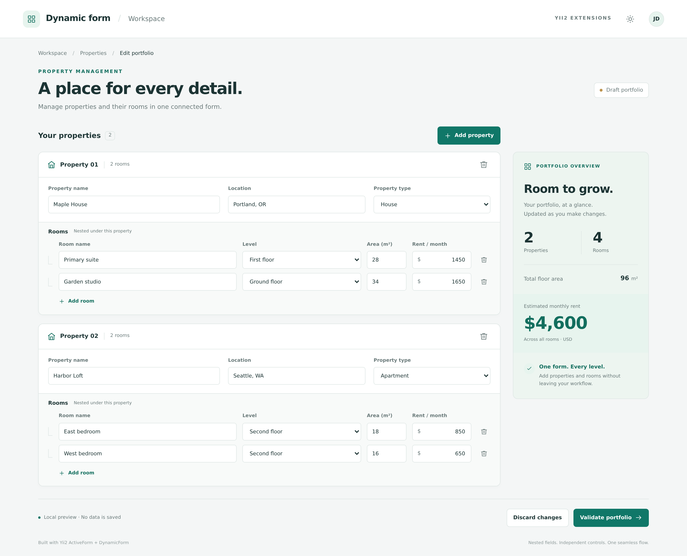

<!-- markdownlint-disable MD041 -->
<p align="center">
    <picture>
        <source media="(prefers-color-scheme: dark)" srcset="https://www.yiiframework.com/image/design/logo/yii3_full_for_dark.svg">
        <source media="(prefers-color-scheme: light)" srcset="https://www.yiiframework.com/image/design/logo/yii3_full_for_light.svg">
        
    </picture>
    <h1 align="center">Dynamic form</h1>
    <br>
</p>
<!-- markdownlint-enable MD041 -->

<p align="center">
    <a href="https://github.com/yii2-extensions/dynamicform/actions/workflows/build.yml" target="_blank">
        
    </a>
    <a href="https://dashboard.stryker-mutator.io/reports/github.com/yii2-extensions/dynamicform/main" target="_blank">
        
    </a>
    <a href="https://github.com/yii2-extensions/dynamicform/actions/workflows/static.yml" target="_blank">
        
    </a>
    <a href="https://github.com/yii2-extensions/dynamicform/actions/workflows/security.yml" target="_blank">
        
    </a>
</p>

<p align="center">
    <strong>Clone nested form rows in Yii2 ActiveForm</strong><br>
    <em>Tabular inputs, client validation, nested widgets and jQuery events</em>
</p>

Add and remove rows of form fields in the browser while the tabular input names, ids and client validation stay
coherent. The widget wraps the rows rendered by `ActiveForm`, and the `Model` helper rebuilds the posted rows on the
server.

<picture>
    <source media="(prefers-color-scheme: dark)" srcset="images/dynamicform-dark.png">
    <source media="(prefers-color-scheme: light)" srcset="images/dynamicform-light.png">
    
</picture>

## Quick start

### Installation

```bash
composer require --prefer-dist yii2-extensions/dynamicform:^2.0
```

### Basic usage

Wrap the rows of a tabular form with `DynamicFormWidget::begin()` and `end()`:

```php
use yii\helpers\Html;
use yii\widgets\ActiveForm;
use Yii2\Extensions\DynamicForm\DynamicFormWidget;

$form = ActiveForm::begin(['id' => 'dynamic-form']);

DynamicFormWidget::begin(
    [
        'widgetContainer' => 'dynamicform_wrapper',
        'widgetBody' => '.container-items',
        'widgetItem' => '.item',
        'limit' => 4,
        'min' => 1,
        'insertButton' => '.add-item',
        'deleteButton' => '.remove-item',
        'model' => $modelsAddress[0],
        'formId' => 'dynamic-form',
        'formFields' => ['full_name', 'city'],
    ],
);
?>
<div class="container-items">
    <?php foreach ($modelsAddress as $i => $modelAddress): ?>
        <div class="item">
            <?= $form->field($modelAddress, "[{$i}]full_name")->textInput() ?>
            <?= $form->field($modelAddress, "[{$i}]city")->textInput() ?>
            <button type="button" class="add-item">+</button>
            <button type="button" class="remove-item">-</button>
        </div>
    <?php endforeach; ?>
</div>
<?php
DynamicFormWidget::end();

echo Html::submitButton('Save');

ActiveForm::end();
```

On the server, `Model::createMultiple()` builds one `Address` model per posted row; the
[usage examples](docs/examples.md) show the complete create and update actions.

## Documentation

- 📚 [Installation guide](docs/installation.md)
- ⚙️ [Configuration guide](docs/configuration.md)
- 💡 [Usage examples](docs/examples.md)
- 🧪 [Testing guide](docs/testing.md)

## AI assistance

AI agents: read the [documentation index](https://yii2-framework.github.io/docs/llms.txt) and fetch the Markdown version
of a page by appending `index.md` to its URL. The
[AI agents guide](https://yii2-framework.github.io/docs/project/ai-agents/) covers skill installation, client setup and
verification.

- 🤖 [`yii2-dynamicform` skill](docs/agents.md): Dynamic form rows.
- 🧭 [`yii2-framework` skill](https://yii2-framework.github.io/docs/guide/skills/yii2-framework/): Yii 22.0 application
  conventions.

The hosted documentation covers Yii 22.0. If it does not match the installed revision or is unavailable, use the
[repository guides](#documentation), the [skill source](skills/yii2-dynamicform/SKILL.md), the source PHPDoc and the
[changelog](CHANGELOG.md).

## Package information

[](https://www.php.net/releases/8.1/en.php)
[](https://github.com/yiisoft/yii2/releases/tag/2.0.55)
[](https://github.com/yiisoft/yii2/tree/22.0)
[](https://packagist.org/packages/yii2-extensions/dynamicform)
[](https://packagist.org/packages/yii2-extensions/dynamicform)
[](https://github.com/yii2-extensions/dynamicform/actions/workflows/static.yml)

## Code quality

[](https://codecov.io/github/yii2-extensions/dynamicform)
[](https://github.com/yii2-extensions/dynamicform/actions/workflows/quality.yml)
[](https://github.com/yii2-extensions/dynamicform/actions/workflows/assets.yml)
[](https://github.com/yii2-extensions/dynamicform/actions/workflows/ecs.yml)

## Special thanks

This extension was created by Wanderson Bragança and hosted at
[wbraganca/yii2-dynamicform](https://github.com/wbraganca/yii2-dynamicform). We thank him for his work; for continuity
and maintenance we have moved a copy here and preserve his identity throughout the code he wrote.

## Our social networks

[](https://x.com/Terabytesoftw)
[](https://www.facebook.com/wilmer.arambula.9)
[](https://www.reddit.com/r/Yii2/)
[](https://t.me/yii_framework_in_english)

## Built with AI

[](https://claude.com/claude-code)
[](https://openai.com/codex)
[](https://www.coderabbit.ai)

## License

[](LICENSE.md)
