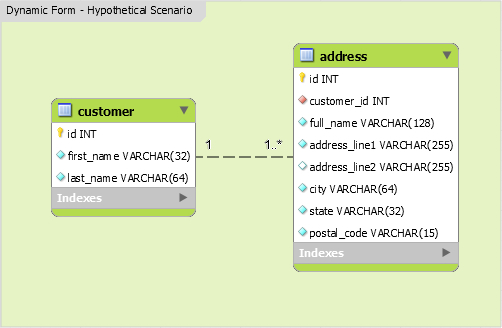

# Usage examples

The examples build an address book: each customer has several addresses, edited together in one form.



## Models

Two Active Record classes map the tables; nothing specific to the extension is needed in them.

```php
namespace app\models;

use yii\db\ActiveRecord;

class Customer extends ActiveRecord
{
    public static function tableName()
    {
        return 'customer';
    }

    public function getAddresses()
    {
        return $this->hasMany(Address::class, ['customer_id' => 'id']);
    }
}
```

```php
namespace app\models;

use yii\db\ActiveRecord;

class Address extends ActiveRecord
{
    public static function tableName()
    {
        return 'address';
    }
}
```

## Create action

`Model::createMultiple()` creates one `Address` per posted row; the rows are loaded, validated and saved inside one
transaction.

```php
namespace app\controllers;

use app\models\{Address, Customer};
use Exception;
use Yii;
use yii\helpers\ArrayHelper;
use yii\web\{Controller, Response};
use yii\widgets\ActiveForm;
use Yii2\Extensions\DynamicForm\Models\Model;

class CustomerController extends Controller
{
    public function actionCreate()
    {
        $modelCustomer = new Customer();
        $modelsAddress = [new Address()];

        if ($modelCustomer->load(Yii::$app->request->post())) {
            $modelsAddress = Model::createMultiple(Address::class);

            Model::loadMultiple($modelsAddress, Yii::$app->request->post());

            // ajax validation
            if (Yii::$app->request->isAjax) {
                Yii::$app->response->format = Response::FORMAT_JSON;

                return ArrayHelper::merge(
                    ActiveForm::validateMultiple($modelsAddress),
                    ActiveForm::validate($modelCustomer),
                );
            }

            // validate all models
            $valid = $modelCustomer->validate();
            $valid = Model::validateMultiple($modelsAddress) && $valid;

            if ($valid) {
                $transaction = Yii::$app->db->beginTransaction();

                try {
                    if ($flag = $modelCustomer->save(false)) {
                        foreach ($modelsAddress as $modelAddress) {
                            $modelAddress->customer_id = $modelCustomer->id;

                            if (!($flag = $modelAddress->save(false))) {
                                $transaction->rollBack();

                                break;
                            }
                        }
                    }

                    if ($flag) {
                        $transaction->commit();

                        return $this->redirect(['view', 'id' => $modelCustomer->id]);
                    }
                } catch (Exception $e) {
                    $transaction->rollBack();
                }
            }
        }

        return $this->render('create', [
            'modelCustomer' => $modelCustomer,
            'modelsAddress' => empty($modelsAddress) ? [new Address()] : $modelsAddress,
        ]);
    }
}
```

## Update action

Passing the stored addresses and their primary key to `Model::createMultiple()` reuses the models whose key was posted
and creates the rest; the keys that are no longer posted are deleted.

```php
namespace app\controllers;

use app\models\{Address, Customer};
use Exception;
use Yii;
use yii\helpers\ArrayHelper;
use yii\web\{Controller, Response};
use yii\widgets\ActiveForm;
use Yii2\Extensions\DynamicForm\Models\Model;

class CustomerController extends Controller
{
    public function actionUpdate($id)
    {
        $modelCustomer = $this->findModel($id);
        $modelsAddress = $modelCustomer->addresses;

        // primary key of $modelsAddress
        $pkey = 'id';

        if ($modelCustomer->load(Yii::$app->request->post())) {
            $oldIDs = ArrayHelper::map($modelsAddress, $pkey, $pkey);
            $modelsAddress = Model::createMultiple(Address::class, $modelsAddress, $pkey);

            Model::loadMultiple($modelsAddress, Yii::$app->request->post());

            $deletedIDs = array_diff($oldIDs, array_filter(ArrayHelper::map($modelsAddress, $pkey, $pkey)));

            // ajax validation
            if (Yii::$app->request->isAjax) {
                Yii::$app->response->format = Response::FORMAT_JSON;

                return ArrayHelper::merge(
                    ActiveForm::validateMultiple($modelsAddress),
                    ActiveForm::validate($modelCustomer),
                );
            }

            // validate all models
            $valid = $modelCustomer->validate();
            $valid = Model::validateMultiple($modelsAddress) && $valid;

            if ($valid) {
                $transaction = Yii::$app->db->beginTransaction();

                try {
                    if ($flag = $modelCustomer->save(false)) {
                        if (!empty($deletedIDs)) {
                            Address::deleteAll([$pkey => $deletedIDs]);
                        }

                        foreach ($modelsAddress as $modelAddress) {
                            $modelAddress->customer_id = $modelCustomer->id;

                            if (!($flag = $modelAddress->save(false))) {
                                $transaction->rollBack();

                                break;
                            }
                        }
                    }

                    if ($flag) {
                        $transaction->commit();

                        return $this->redirect(['view', 'id' => $modelCustomer->id]);
                    }
                } catch (Exception $e) {
                    $transaction->rollBack();
                }
            }
        }

        return $this->render('update', [
            'modelCustomer' => $modelCustomer,
            'modelsAddress' => empty($modelsAddress) ? [new Address()] : $modelsAddress,
        ]);
    }
}
```

## View

The view renders the customer fields and, inside the widget, one panel per address. Each panel carries its own insert
and delete buttons, and stored addresses keep their hidden primary key.

```php
use yii\helpers\Html;
use yii\widgets\ActiveForm;
use Yii2\Extensions\DynamicForm\DynamicFormWidget;
?>

<div class="customer-form">
    <?php $form = ActiveForm::begin(['id' => 'dynamic-form']); ?>
    <div class="row">
        <div class="col-sm-6">
            <?= $form->field($modelCustomer, 'first_name')->textInput(['maxlength' => true]) ?>
        </div>
        <div class="col-sm-6">
            <?= $form->field($modelCustomer, 'last_name')->textInput(['maxlength' => true]) ?>
        </div>
    </div>

    <div class="panel panel-default">
        <div class="panel-heading"><h4><i class="glyphicon glyphicon-envelope"></i> Addresses</h4></div>
        <div class="panel-body">
            <?php DynamicFormWidget::begin([
                'widgetContainer' => 'dynamicform_wrapper', // required: only alphanumeric characters plus "_" [A-Za-z0-9_]
                'widgetBody' => '.container-items', // required: css class selector
                'widgetItem' => '.item', // required: css class
                'limit' => 4, // the maximum times, an element can be cloned (default 999)
                'min' => 1, // 0 or 1 (default 1)
                'insertButton' => '.add-item', // css class
                'deleteButton' => '.remove-item', // css class
                'model' => $modelsAddress[0],
                'formId' => 'dynamic-form',
                'formFields' => [
                    'full_name',
                    'address_line1',
                    'address_line2',
                    'city',
                    'state',
                    'postal_code',
                ],
            ]); ?>

            <div class="container-items"><!-- widgetBody -->
            <?php foreach ($modelsAddress as $i => $modelAddress): ?>
                <div class="item panel panel-default"><!-- widgetItem -->
                    <div class="panel-heading">
                        <h3 class="panel-title pull-left">Address</h3>
                        <div class="pull-right">
                            <button type="button" class="add-item btn btn-success btn-xs"><i class="glyphicon glyphicon-plus"></i></button>
                            <button type="button" class="remove-item btn btn-danger btn-xs"><i class="glyphicon glyphicon-minus"></i></button>
                        </div>
                        <div class="clearfix"></div>
                    </div>
                    <div class="panel-body">
                        <?php
                            // necessary for update action.
                            if (!$modelAddress->isNewRecord) {
                                echo Html::activeHiddenInput($modelAddress, "[{$i}]id");
                            }
                        ?>
                        <?= $form->field($modelAddress, "[{$i}]full_name")->textInput(['maxlength' => true]) ?>
                        <div class="row">
                            <div class="col-sm-6">
                                <?= $form->field($modelAddress, "[{$i}]address_line1")->textInput(['maxlength' => true]) ?>
                            </div>
                            <div class="col-sm-6">
                                <?= $form->field($modelAddress, "[{$i}]address_line2")->textInput(['maxlength' => true]) ?>
                            </div>
                        </div><!-- .row -->
                        <div class="row">
                            <div class="col-sm-4">
                                <?= $form->field($modelAddress, "[{$i}]city")->textInput(['maxlength' => true]) ?>
                            </div>
                            <div class="col-sm-4">
                                <?= $form->field($modelAddress, "[{$i}]state")->textInput(['maxlength' => true]) ?>
                            </div>
                            <div class="col-sm-4">
                                <?= $form->field($modelAddress, "[{$i}]postal_code")->textInput(['maxlength' => true]) ?>
                            </div>
                        </div><!-- .row -->
                    </div>
                </div>
            <?php endforeach; ?>
            </div>
            <?php DynamicFormWidget::end(); ?>
        </div>
    </div>

    <div class="form-group">
        <?= Html::submitButton($modelCustomer->isNewRecord ? 'Create' : 'Update', ['class' => 'btn btn-primary']) ?>
    </div>

    <?php ActiveForm::end(); ?>
</div>
```

Listen to the widget events described in the [configuration guide](configuration.md#javascript-events) to confirm
deletions or react to inserted rows.

[Back to documentation](../README.md#documentation)
